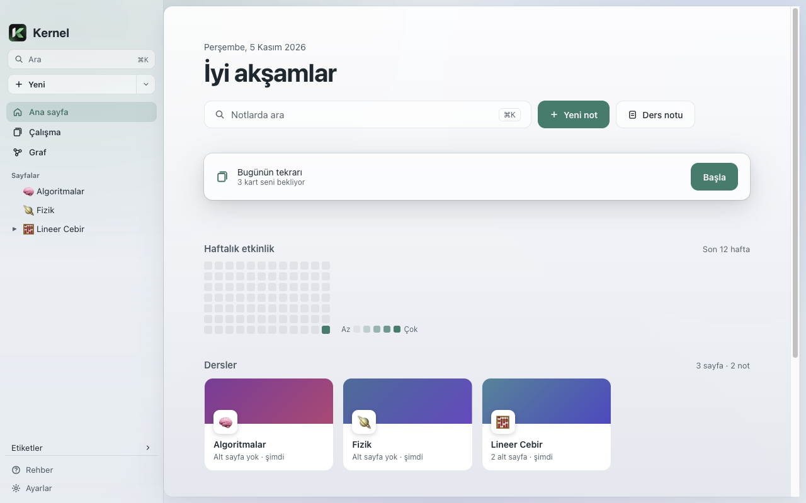

<p align="center">
  
</p>

<h1 align="center">Kernel</h1>

<p align="center">
  Notların senin bilgisayarında kalır. Lokal, açık kaynak, Markdown tabanlı macOS not uygulaması.<br>
  <em>Your notes stay on your Mac. A local, open-source, Markdown-based note app for macOS.</em>
</p>

<p align="center">
  <a href="https://github.com/serhandenizhan/kernel/releases/latest"></a>
</p>

<p align="center">
  <a href="#türkçe">Türkçe</a> · <a href="#english">English</a>
</p>

<p align="center">
  
</p>

---

## Türkçe

Kernel, ders notları ve kişisel bilgi için yapılmış bir not uygulaması. Her sayfa diskte düz bir `.md` dosyasıdır: hesap yok, bulut yok, abonelik yok. Notlarını istediğin editörde açabilir, iCloud ya da Git ile yedekleyebilirsin.

### Öne çıkanlar

- **Rahat yazma** — `/` blok menüsü, başlıklar, listeler, callout'lar, toggle'lar, tablolar, kod blokları ve Mermaid diyagramları.
- **Formüller** — `$…$` ve `$$…$$` ile LaTeX; akıllı yapıştırma, ChatGPT ya da web sayfalarından kopyalanan formülleri ve kodu tanır.
- **Bilgi ağı** — `[[` ile sayfalar arası link, her sayfanın altında geri bağlantılar, `#etiket`ler ve tüm notların grafı. Bir sayfanın adını değiştirince linkler kendiliğinden güncellenir.
- **Flashcard'lar** — bir satıra `Soru :: Cevap` yaz; Kernel kartları FSRS ile aralıklı tekrar takvimine koyar. Sınav modu ve ana sayfada "Bugünün tekrarı".
- **Ana sayfa** — dersler kartlar halinde, son notlar, sabitlenenler ve etkinlik haritası.
- **Sekmeler ve bölünmüş ekran**, komut paleti (⌘P), arama (⌘K), odak modu (⌘⇧F).
- **Notion'dan geçiş** — sayfaların, alt sayfaların ve görsellerin Markdown'a aktarılır.
- **Dışa aktarma** — PDF, Markdown ve HTML; gömülü PDF'ler.
- **Güvence** — otomatik kayıt, sürüm geçmişi, otomatik yedek.
- **Türkçe, İngilizce ve Almanca** arayüz; açık ve koyu tema.

<p align="center">
  
  
</p>

### Kurulum

**İndir:** [Son sürüm](https://github.com/serhandenizhan/kernel/releases/latest) sayfasından `.dmg` dosyasını indir, `Kernel.app`'i Uygulamalar klasörüne sürükle. Uygulama Apple tarafından imzalanmadığı için ilk açılışta **sağ tık → Aç** demen gerekir. (Apple Silicon Mac gerekir.)

**Kaynaktan derle** (Node.js 22+):

```bash
git clone https://github.com/serhandenizhan/kernel.git
cd kernel
npm install
npm run dist
```

Çıktı: `release/mac-arm64/Kernel.app` ve `release/Kernel-<sürüm>-arm64.dmg`.

### Notların nerede?

İlk açılışta bir **kasa** klasörü seçersin (önerilen: `~/Documents/Kernel`). Her sayfa bir `.md` dosyasıdır; alt sayfalar aynı adlı klasörde, görseller `attachments/` içindedir. Kernel'in ayarları kasadaki gizli `.kernel/` klasöründedir. Hiçbir veri uzak bir sunucuya gönderilmez.

---

## English

Kernel is a note app built for lecture notes and personal knowledge. Every page is a plain `.md` file on your disk: no account, no cloud, no subscription. Open your notes in any editor and back them up with iCloud or Git.

### Highlights

- **Comfortable writing** — `/` block menu, headings, lists, callouts, toggles, tables, code blocks and Mermaid diagrams.
- **Math** — LaTeX with `$…$` and `$$…$$`; smart paste recognises formulas and code copied from ChatGPT or web pages.
- **Knowledge graph** — link pages with `[[`, see backlinks under every page, use `#tags`, and explore a graph of all your notes. Renaming a page updates its links everywhere.
- **Flashcards** — write `Question :: Answer` on a line; Kernel schedules cards with FSRS spaced repetition. Exam mode and "Today's review" on the home page.
- **Home page** — courses as cards, recent notes, pinned pages and an activity map.
- **Tabs and split view**, command palette (⌘P), search (⌘K), focus mode (⌘⇧F).
- **Move from Notion** — pages, subpages and images are imported as Markdown.
- **Export** — PDF, Markdown and HTML; embedded PDFs.
- **Peace of mind** — autosave, version history, automatic backups.
- **Turkish, English and German** interface; light and dark themes.

### Install

**Download:** get the `.dmg` from the [latest release](https://github.com/serhandenizhan/kernel/releases/latest) and drag `Kernel.app` into Applications. The app is not signed by Apple, so the first time you open it, **right-click → Open**. (Requires an Apple Silicon Mac.)

**Build from source** (Node.js 22+): see the commands above.

### Where are my notes?

On first launch you pick a **vault** folder (suggested: `~/Documents/Kernel`). Each page is a `.md` file; subpages live in a folder with the same name, images in `attachments/`. Kernel's own settings are in the hidden `.kernel/` folder. Nothing is sent to a remote server.

---

## Geliştirme · Development

```bash
npm run dev         # geliştirme modu · dev mode
npm test            # birim testleri · unit tests (Vitest)
npm run test:e2e    # uçtan uca testler · end-to-end tests (Playwright + Electron)
npm run typecheck
```

Testler yalnızca geçici klasörler kullanır. · Tests only use temporary folders.

## Lisans · License

MIT
